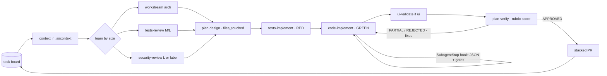

# Orchestrator map

Installed by [vinifig-claude-orchestrator](https://github.com/vinifig/vinifig-claude-orchestrator) ({{ORCH_VERSION}}). Re-run the installer to update; files you edited are kept (the new version lands as `*.orchestrator-new`).

## Commands

| Command | What it does |
|---|---|
| `/initiative-execute <ask>` | decides task vs epic (JSON decision) and runs it |
| `/initiative-plan <ask>` | only decides, sizes the team and writes the epic to the board |
| `/epic-execute <epic> [parallel] [skip-ui]` | waves by `blocked_by`, a sized team per task, stacked PRs, resumable |
| `/task-execute <verb> <ask>` | one task: context → plan gate → execution → review |
| `/task-board` | the port to local `.ai/board/`, GitHub Issues or Linear |
| `/ui-validate`, `/ui-review` | real screenshots; rubric-scored UI review |
| `/eval-suite-run` | replays solved tasks to measure the orchestrator itself |
| `/specialists-review`, `/delivery-audit` | dynamic-workflow pilots (off by default: `workflows` in `orchestrator.json`) |

## Flow of one task (sequential-teams)



## Files

| Path | In git | What |
|---|---|---|
| `.claude/orchestrator.json` | yes | language, approver, workstreams (paths, arch agent, gates), team sizes and models, guards, pilots, prices |
| `.claude/agents/*.md` | yes | role briefs; each ends with a JSON block |
| `.claude/skills/*/SKILL.md` | yes | the flows above |
| `.claude/hooks/*.py` | yes | guards (git, secrets), JSON and gate checks at agent stop, telemetry |
| `.claude/orchestrator/bin/orch.py` | yes | state, events, waves, overlap, gates, team, cost, evals |
| `.claude/orchestrator/schemas/` | yes | agent-output, plan-output, verdict, initiative-decision, state |
| `.claude/orchestrator/rubrics/` | yes | plan-verify and ui-review rubrics + `examples/` for calibration |
| `.claude/orchestrator/rules/<role>.md` | yes | project/stack rules each agent reads (from the preset and overlays) |
| `.claude/workflows/*.js` | yes | dynamic workflow pilots |
| `.ai/plans/` | yes | plans and execution reports |
| `.ai/evals/cases/`, `baseline.json` | yes | eval cases |
| `.ai/board/`, `.ai/context/`, `.ai/evals/runs/` | no | local tasks, run state (`state.json`, `events.jsonl`, `_wave_strategy.md`), eval runs |

## Useful commands

```bash
ORCH="python3 .claude/orchestrator/bin/orch.py"
$ORCH state show <epic>        # where the epic is
$ORCH cost <epic>              # tokens, time, rounds per task and per agent
$ORCH gates --workstream <ws> --run
$ORCH waves .ai/board/<epic>.yaml
```
